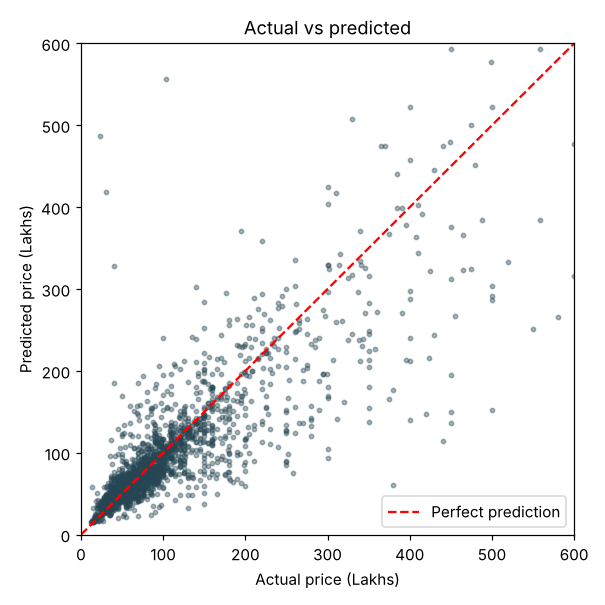
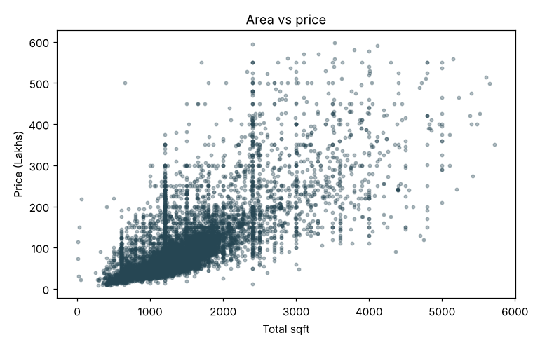
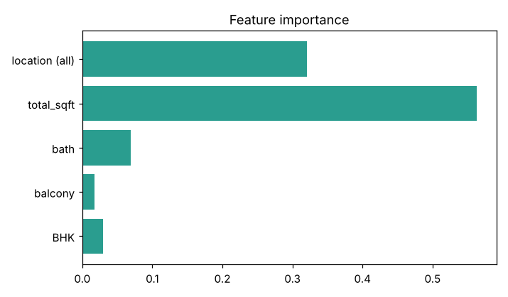

# Supervised Regression: Bangalore House Price Prediction

A supervised machine learning project that predicts the price of a house in Bangalore (in **Lakhs**) from its location, size, bathrooms, balconies and BHK, using a **Random Forest Regressor** (scikit-learn).

## Dataset

`datasets/bangalore_house_data.csv` — 13,320 house listings (12,524 usable rows after cleaning).

| Column | Description |
|---|---|
| `location` | Neighbourhood in Bangalore (1,305 unique values) |
| `size` | Size of the house, e.g. `2 BHK`, `4 Bedroom` |
| `total_sqft` | Total area in square feet |
| `bath` | Number of bathrooms |
| `balcony` | Number of balconies |
| `price` | Target: price in Lakhs |

Other columns (`area_type`, `availability`, `society`) are present in the file but not used by the model.

## Project Structure

```
supervised-regression/
├── datasets/
│   └── bangalore_house_data.csv
├── notebooks/
│   └── house_price_regression.ipynb
├── images/
│   ├── price_distribution.png
│   ├── sqft_vs_price.png
│   ├── top_locations.png
│   ├── price_by_bhk.png
│   ├── actual_vs_predicted.png
│   └── feature_importance.png
├── bangalore_model.py       # trains the model and saves model.pkl
├── app.py                   # predicts a sample house
├── location_predictor.py    # interactive prediction from user input
├── requirements.txt
├── .gitignore
└── README.md
```

## Workflow

1. Load the data and keep the useful columns
2. Drop missing values and convert `total_sqft` to numbers (ranges like `2100 - 2850` are removed)
3. Extract the BHK number from the `size` column
4. One-hot encode `location`, impute numeric features with the median
5. Train a Random Forest (100 trees) in a scikit-learn `Pipeline`
6. Evaluate with Mean Absolute Error and R² on a 20% test set

## Results

| Metric | Value |
|---|---|
| Mean Absolute Error | ~32 Lakhs |
| R² Score | ~0.53 |





The model captures the general trend but is weaker on expensive properties. Extreme prices and outliers in the data limit accuracy, so this is a solid baseline rather than a production-ready estimator.

## How to Run

```bash
# 1. Clone the repository
git clone https://github.com/<your-username>/supervised-regression.git
cd supervised-regression

# 2. Create and activate a virtual environment
python -m venv venv
venv\Scripts\activate        # Windows
# source venv/bin/activate   # macOS / Linux

# 3. Install dependencies
pip install -r requirements.txt

# 4. Train the model (creates model.pkl)
python bangalore_model.py

# 5. Make predictions
python app.py                  # sample prediction
python location_predictor.py   # interactive prediction
```

> `model.pkl` is about 75 MB, so it is not stored in this repository. Run `bangalore_model.py` to generate it.

## Tech Stack

Python, pandas, NumPy, matplotlib, scikit-learn, Jupyter

## Future Improvements

- Remove price and area outliers before training
- Group rare locations into an "Other" category to reduce dimensionality
- Try Gradient Boosting / XGBoost and compare results
- Tune hyperparameters with cross-validation
- Build a small web app (Streamlit or Flask) for predictions
